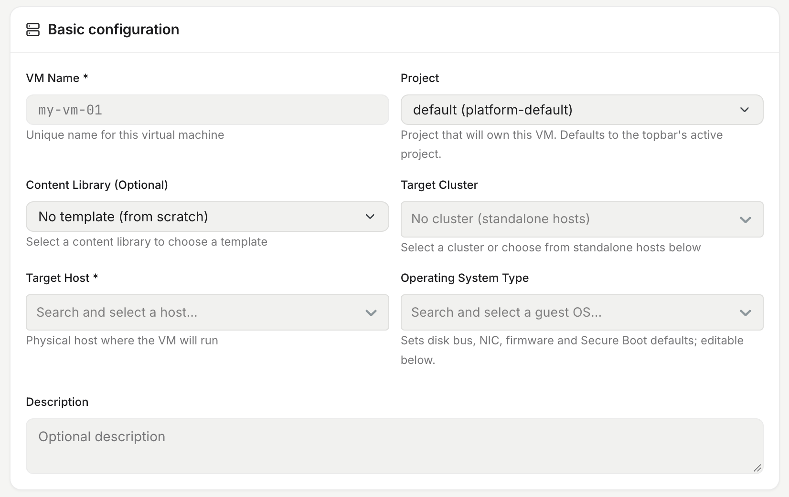
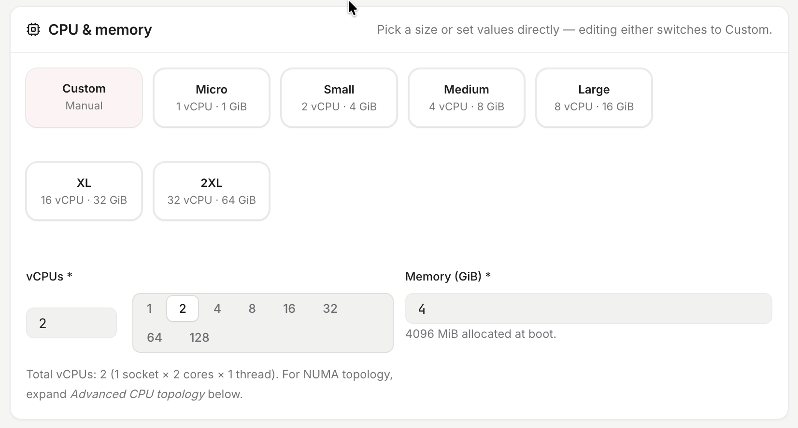
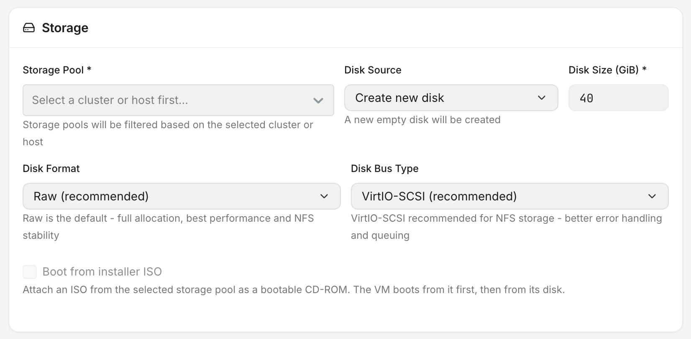
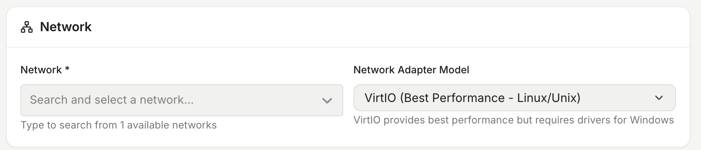

import DirectorLimitedAvailability from '/snippets/director-limited-availability.mdx';

<DirectorLimitedAvailability />

A virtual machine (VM) in Talos Director is a computer that runs on one of your hosts, with its own share of the host's CPU, memory, storage, and network. This page shows how to create a VM with the **Create Virtual Machine** form and power it on, and lists the other ways Talos Director creates VMs.

## Before you begin

Ensure you have the following:

- At least one host. To add a host, see [Hosts](/director/compute/hosts).
- A storage pool that the host can reach. The VM's disk is stored in this pool. To add a storage pool, see [Add a storage pool](/director/compute/storage-pools#add-a-storage-pool).
- A virtual network for the VM to join. To create a network, see [Create a virtual network](/director/networking/virtual-networks#create-a-virtual-network).
- An ISO or disk image of the operating system, such as [Ubuntu Server](https://ubuntu.com/download/server). You don't need one if you use a template.

## Create a VM from the console

You create a VM in three steps. First, choose where its operating system comes from. Then, fill in the **Create Virtual Machine** form. Finally, review your settings and create the VM.

### Step 1: Choose an operating system source

Every VM needs an operating system. Talos Director can get it from three sources:

- **Installer ISO**: The VM boots from an installation image, and you install the operating system on it, the same way as on a physical server.
- **Template**: The VM is a copy of a prepared VM from a content library. It starts with the operating system already installed.
- **Existing disk**: The VM boots from a disk image that already has an operating system installed.

Select the tab for your source:

<Tabs>
  <Tab title="Installer ISO">
    Upload the ISO to the root folder of a storage pool. The form only lists ISOs in the root folder.

    To upload an ISO:

    1. Navigate to **Storage** > **Storage Pools** and select the storage pool.
    2. Select the **Browse** tab, then select **Upload**.
    3. Under **Source**, choose where the ISO comes from:
       - **From This Computer**: Select **Select File** and choose the ISO.
       - **From URL**: Enter the ISO's download link under **URL**. Talos Director downloads the file into the pool.
    4. Leave **Upload to** set to **/ (pool root)**.
    5. Select **Upload**, or **Download** for a URL.

    To check the upload's progress, select **Transfers** in the top bar.

    In Step 2, you select this ISO in the **Storage** section of the form.
  </Tab>
  <Tab title="Template">
    Templates are stored in content libraries. To create a template, see [Templates and Content Libraries](/director/compute/templates-and-content-libraries).

    In Step 2, you select the template in the **Basic configuration** section of the form.
  </Tab>
  <Tab title="Existing disk">
    Upload the disk image to a storage pool. The disk image must be a raw, QCOW2, or IMG file.

    To upload a disk image:

    1. Navigate to **Storage** > **Storage Pools** and select the storage pool.
    2. Select the **Browse** tab, then select **Upload**.
    3. Under **Source**, choose where the disk image comes from:
       - **From This Computer**: Select **Select File** and choose the disk image.
       - **From URL**: Enter the disk image's download link under **URL**. Talos Director downloads the file into the pool.
    4. Under **Upload to**, choose the folder for the disk image.
    5. Select **Upload**, or **Download** for a URL.

    To check the upload's progress, select **Transfers** in the top bar.

    In Step 2, you select this disk image in the **Storage** section of the form.
  </Tab>
</Tabs>

### Step 2: Configure the virtual machine

To open the form, navigate to **Compute** > **Virtual Machines** > **All VMs** and select **Create VM**.

The optional sections are collapsed, and their defaults suit most VMs.

The form has the following sections, from top to bottom:

- **Basic configuration**: The VM's name, owner, template, host, and operating system.
- **CPU & memory**: How many vCPUs and how much memory the VM gets.
- **Storage**: The VM's disk, and the installer ISO it boots from.
- **Network**: The virtual network the VM joins.
- **Firmware & console (optional)**: How the VM boots, and how its console is reached.
- **Advanced CPU topology (optional)**: How the vCPUs are presented to the guest.
- **Scheduling & NUMA (optional)**: How the host shares CPU time with the VM, and whether the VM can be moved.
- **Advanced VM Parameters (optional)**: A read-only preview of the VM's hypervisor configuration.
- **Guest customization (optional)**: The hostname, network, and SSH keys applied when the VM first boots.

#### Basic configuration

**Basic configuration** names the VM and decides which host it runs on.

<Note>
Legacy operating systems, such as Windows Server 2012 R2 and Red Hat Enterprise Linux 6, run on the older `pc-i440fx` machine type with IDE disks and an e1000 network adapter. The cluster needs a host that offers `pc-i440fx` to run them.
</Note>

Complete the following fields:

| **Field** | **Description** |
| --- | --- |
| **VM Name** | Required. A unique name for the VM. |
| **Project** | The project that owns the VM. Defaults to the project selected in the top bar. |
| **Content Library** | Optional. Select a content library, then a template under **Select Template**, to clone the VM from that template. Leave it on **No template (from scratch)** to build the VM from the settings in this form. |
| **Target Cluster** | The cluster the VM belongs to, or **No cluster (standalone hosts)**. |
| **Target Host** | Required. In a cluster, **Any host in cluster (scheduler decides)** lets the Resource Scheduler pick the host, or a specific host can be selected. Without a cluster, select a standalone host. |
| **Operating System Type** | The guest operating system, such as Ubuntu 24.04 LTS or Windows Server 2025. It sets the default disk bus, network adapter, firmware, and Secure Boot in the later sections, and each default can still be changed. |
| **Description** | Optional. A description of the VM. |

#### CPU & memory

**CPU & memory** sets the VM's size. Select a preset, from **Micro** (1 vCPU and 1 GiB) to **2XL** (32 vCPUs and 64 GiB), or set **vCPUs** and **Memory (GiB)** directly. Editing either value switches the size to **Custom**.

By default, the vCPUs are presented to the guest as one socket with one thread per core. To change that layout, see [Advanced CPU topology](#advanced-cpu-topology-optional).

#### Storage

**Storage** creates the VM's disk, or attaches a disk that already exists.

Complete the following fields:

| **Field** | **Description** |
| --- | --- |
| **Storage Pool** | Required. The storage pool that holds the disk. The list shows only the pools that the selected cluster or host can reach. |
| **Disk Source** | **Create new disk** creates an empty disk. **Use existing disk from storage pool** uses a disk image that is already in the pool. Select the disk under **Select existing disk**, or enter its full path. |
| **Disk Size (GiB)** | Required for a new disk. The size of the disk. The default is 40. |
| **Disk Format** | **Raw (recommended)** allocates the full disk up front, for the best performance and stability on NFS. **QCOW2** allocates space as it is used and supports snapshots. |
| **Disk Bus Type** | **VirtIO-SCSI (recommended)** suits most VMs and is recommended on NFS storage. **VirtIO-blk** is the fastest option for Linux guests. **SATA** needs no extra drivers, and **IDE** is for legacy guests. |

To install the operating system from an ISO, select **Boot from installer ISO**, then choose the ISO under **ISO File**. The VM starts from the ISO first, then from its disk.

#### Network

**Network** attaches the VM's first network interface. More interfaces can be added after the VM is created, from the **Network** tab of the VM's detail screen.

Complete the following fields:

| **Field** | **Description** |
| --- | --- |
| **Network** | Required. The virtual network that the interface joins. |
| **Network Adapter Model** | **VirtIO** gives the best performance, and Windows guests need VirtIO drivers to use it. **Intel E1000E** and **Intel E1000** work with Windows without extra drivers, and **Realtek RTL8139** is for legacy guests. |

#### Firmware & console (optional)

**Firmware & console** sets how the VM boots and how its console is reached.

Set the following options:

- **Firmware**: **UEFI** or **BIOS (Legacy)**.
- **Enable Secure Boot (UEFI only)**: Boots only signed boot loaders and kernels.
- **Enable virtual TPM 2.0 (UEFI only)**: Gives the guest an emulated TPM. Windows 11 and Windows Server 2025 require one, so it is on by default for Windows guests on UEFI. The VM is placed only on hosts that provide the TPM emulator.
- **Enable VNC Console**: Adds a graphical console. A serial console is always available.

#### Advanced CPU topology (optional)

**Advanced CPU topology** changes how the vCPUs are presented to the guest. Workloads that are sensitive to NUMA, such as databases, can benefit from a custom layout.

Set the following options:

- **CPU Profile**: The CPU model and features that the guest sees. **Default** uses the cluster's baseline for the operating system. A VM can live-migrate only to hosts whose CPUs support its profile.
- **CPU Sockets**, **Cores per Socket**, and **Threads per Core**: The layout of the vCPUs. Their product is the total number of vCPUs.

#### Scheduling & NUMA (optional)

**Scheduling & NUMA (advanced)** controls how the host shares CPU time with the VM, and whether the Resource Scheduler moves it.

Set the following options:

- **Scheduler QoS class**: **Burstable** reserves a baseline and lets the VM use more CPU when the host has capacity free. It suits most workloads. The other classes are **Guaranteed** and **Best-effort**.
- **CPU reservation (%)**: A guaranteed share of the VM's vCPUs. Any value above 0 reserves dedicated host CPUs, and a host that cannot provide them refuses the VM.
- **CPU limit (%)**: A hard ceiling on the VM's CPU use. 0 means unlimited.
- **Do not move (pin to its host)**: Stops the Resource Scheduler from migrating the VM automatically. Manual migration still works.
- **Guest NUMA topology**: **Auto** lets the platform decide. This matters only for VMs larger than one NUMA node on the host.

#### Advanced VM Parameters (optional)

**Advanced VM Parameters** shows the KVM domain XML that the selections in the form describe. It is for reference only and is not sent with the request.

#### Guest customization (optional)

**Guest customization** is off by default, so the VM boots its image unchanged. When it is on, cloud-init on Linux or cloudbase-init on Windows applies its settings on first boot. **Start from a saved spec** fills the fields from a saved customization spec, and **Advanced: extra cloud-config** adds raw cloud-config for Linux guests.

Set the following options:

- **OS family**: **Auto-detect** reads the operating system from the template or VM. **Linux (cloud-init)** and **Windows (cloudbase-init)** set it explicitly.
- **Hostname**: Defaults to the VM name.
- **IP address**, **Gateway**, and **DNS servers**: A static network configuration. An empty IP address uses DHCP.
- **SSH authorized keys**: Public keys allowed to sign in, one per line.

### Step 3: Review and create the virtual machine

The **VM summary** panel beside the form lists the VM's host, storage, size, disk, network adapter, operating system, firmware, TPM, and console as they are currently set. The **Equivalent API** panel shows the same request as a `curl` command or a JSON body, for creating similar VMs from a script.

To review and create the VM:

1. Check the values in the **VM summary** panel, and correct any section that needs it.
2. To leave the VM powered off after it is created, clear **Power on after creation**. It is selected by default.
3. Select **Create Virtual Machine**.

The VM then appears in **Compute** > **Virtual Machines** > **All VMs**. Select its name to open the VM's detail screen, where **Open Full Console** connects to it. See [Virtual Machines](/director/compute/virtual-machines#the-vm-detail-screen).

## Other ways to create a virtual machine

The form suits creating one VM at a time from scratch or from a template. Talos Director also creates VMs in the following ways:

- **Clone an existing VM**: **Clone VM** in a VM's **Actions** menu creates a copy of that VM. It is the quickest way to make another VM like one that already works. See [Row actions](/director/compute/virtual-machines#row-actions).
- **Import from VMware**: Talos Director connects to VMware vCenter and converts its VMs to run on Talos Director. See [Migrate from VMware](/director/compute/migrate-from-vmware).
- **Use the API**: The form sends a single request to the Talos Director API, which scripts and automation can send directly. The form's **Equivalent API** panel shows that request for the current settings. See [API and Automation](/director/overview/api-and-automation).
- **Create a Kubernetes cluster**: Talos Director creates and manages the VMs that run the cluster's nodes, so they are not created one by one. See [Kubernetes Clusters](/director/kubernetes/kubernetes-clusters).
