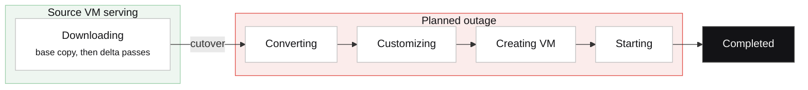

import DirectorLimitedAvailability from '/snippets/director-limited-availability.mdx';

<DirectorLimitedAvailability />

[Migrate from VMware](/director/compute/migrate-from-vmware) walks through the wizard. This page explains what the conversion engine does once you click **Convert**: where the work runs, what each stage changes, what each cutover mode means for the source VM, and what happens if something goes wrong in the middle.

## Converting VMs in waves

For a large estate, migration assessment tooling inventories the vCenter environment and groups its VMs into waves, and mass conversion runs a wave's jobs together. Each VM in a wave is still its own conversion job, with the stages, cutover modes, and rollback described on this page.

## Where the conversion runs

A conversion is a job that runs on the Talos Director host you selected in the wizard, the one that will own the converted VM. The control plane dispatches the job and tracks its progress, while the host does the copying and conversion, because it is already attached to the destination storage pool and has the fastest path to it.

The conversion tools (the disk copier, `qemu-img`, the guest customization tooling) do not run on the host directly. Talos Linux hosts are immutable, so nothing is installed on them. Instead, each job runs in its own isolated, unprivileged tool container on the host, started for that job and removed when it finishes. The container can access only that job's source and its destination pool, cannot read storage credentials, and runs under a resource ceiling so a conversion does not starve the VMs already running on the host.

## Requirements

The wizard's **Requirements** step checks the source VM before any data is copied. The conversion does not start until all three requirements are met.

- **Guest credentials:** an account in the guest OS, used to read the network configuration and apply post-boot configuration.
- **No existing vCenter snapshots:** the engine creates and removes its own snapshots during a warm conversion and needs a clean chain to do that safely.
- **VirtIO drivers and the QEMU guest agent in the guest:** on KVM the VM's disks and network interfaces are VirtIO devices. For Linux the engine also rebuilds the initramfs with VirtIO drivers during customization; for Windows the drivers must be present before conversion, and the step links to the driver ISO.

Scheduled and automatic cutover require **VMware's Virtual Disk Development Kit (VDDK)**. VDDK is the library that reads changed blocks from a running VM's disks. It is VMware software, so Talos Director does not bundle it. Upload the VDDK archive from your VMware entitlement once, under **Settings** > **VM** > **Conversion**, and Talos Director verifies it and distributes it to hosts. A scheduled or automatic job fails before copying anything if no VDDK has been uploaded. Cold conversions can use VDDK for sparse reads but do not require it.

## Conversion stages

The diagram follows a job with scheduled or automatic cutover. Everything up to the cutover happens while the source VM is still serving. With cold cutover, the source is powered off before Downloading begins, so the whole job falls inside the outage.

The **Conversion Jobs** page shows one status per job. Each status corresponds to the following work.

| **Status** | **What is happening** |
| --- | --- |
| **Downloading** | The source VM's disks are being read from vCenter into the destination storage pool. How depends on the cutover mode (below). |
| **Converting** | The copied disks are converted to the format you chose. Raw needs no conversion, so this stage is immediate. QCOW2 needs a full `qemu-img` pass over every disk, which takes time in proportion to disk size. **virt-v2v** is available for guests that need the legacy path. |
| **Customizing** | The guest is prepared to boot on KVM without anyone logging in. The engine works on the converted disks, not the source VM. It rebuilds the Linux initramfs with VirtIO drivers, removes open-vm-tools from Linux guests, repairs the UEFI boot path (fresh firmware variables, and on Windows a rebuilt boot configuration), removes devices that only existed on VMware, and writes the network identity it read from the source using the method you chose: cloud-init for Linux, Sysprep for Windows, the guest agent for either, or none to use DHCP. If the source had a virtual TPM, the destination gets one too. |
| **Creating VM** | A VM is defined on the destination host with the same CPU and memory, its converted disks, and network interfaces attached to the virtual networks you mapped. |
| **Starting** | The VM boots. Once the guest agent reports in, the engine applies any remaining post-boot configuration, such as a network address it could not write to the disk, and, if you asked for it, removes VMware Tools from a Windows guest. |
| **Completed** | The VM is running on Talos Director. The source VM remains in vCenter, powered off and otherwise unchanged. |

## Cutover modes

The cutover mode decides when the source VM stops and how much of the copy happens while it is still serving. In other words, it decides the downtime of the migration.

### Cold

The source VM is powered off before the copy starts and stays off. The engine reads its disks whole, using the fastest path available: directly from the NFS datastore when the host can mount it, through vCenter's export service, or through VDDK with sparse reads that skip unallocated blocks. Downtime lasts the entire job. Nothing on the source changes during the copy, so this is the simplest and most predictable mode, suited to workloads that tolerate a maintenance window.

### Scheduled cutover

The source VM keeps running. The engine takes a snapshot of it and copies that as the base. The snapshot is quiesced when VMware Tools is running in the guest, so the guest's filesystems are consistent, and crash-consistent when it is not. The engine then runs **delta passes**: take a new snapshot, ask VMware's changed block tracking which blocks changed since the last one, copy only those. Passes repeat until the copy is in sync, and the job then shows **In sync; awaiting scheduled cutover**, running further passes as needed to stay in sync.

At the scheduled time, or when you trigger it, the engine asks the guest to shut down and waits for it to power off, five minutes by default. If the guest has not powered off by then, or VMware Tools is not running to receive the request, the engine powers the source off hard, the same as pulling its power cable. The final delta then comes from a crash-consistent state. For databases and other workloads that need a clean shutdown, stop the application or the guest yourself before the cutover time. After the source is off, the engine copies the final delta and the job moves through the remaining stages.

Two limits bound the wait. The snapshot chain on the source is capped (12 snapshots by default) so redo logs cannot grow without limit while the job waits, and the chain is consolidated once at the end, when no changed-block query depends on it. The engine never consolidates mid-flight, because doing so would corrupt the destination.

### Automatic cutover

Automatic cutover is the same as scheduled cutover without the wait. Delta passes repeat until the changed data in a pass drops below 1% of the disk, or until 20 passes have run, and then the engine shuts the source down and cuts over immediately, the same way as a scheduled cutover. This mode gives the smallest downtime without an operator present, and suits bulk moves where the exact cutover time does not matter.

| **Mode** | **Source VM during copy** | **Downtime** | **VDDK** |
| --- | --- | --- | --- |
| **Cold** | Powered off | The whole job | Optional, for sparse reads |
| **Scheduled cutover** | Running | From shutdown to first boot, at a time you choose | Required |
| **Automatic cutover** | Running | From shutdown to first boot, as soon as the copy converges | Required |

<Note>
The base copy is the longest stage and runs at the speed of the storage network. With scheduled or automatic cutover it happens while the source is still serving. The outage runs from the source's shutdown to the converted VM's first boot: the final delta, conversion to QCOW2 if you chose it, customization, and VM creation all fall inside it. To keep the outage short, choose raw disks, which skip the conversion. The application inside the VM is not changed.
</Note>

## Failure handling and rollback

Each job writes a checkpoint to the host as it progresses. If the host agent restarts mid-job, it reads the checkpoint, finds the job's tool container still running, and re-attaches to it rather than starting over. A long copy survives a host agent upgrade.

You can cancel a job at any stage before completion. Cancel stops the tool container and removes the partial disks from the destination pool. For scheduled and automatic jobs, the engine removes the snapshots it created on the source and turns changed block tracking back off if it was the one that turned it on. Before cutover, the source VM keeps running throughout. After cutover has started, the source is already powered off, and cancelling does not power it back on. Power it on in vCenter to resume service.

Progress is monitored for stalls, so a copy that stops making progress is reported as stalled rather than sitting at the same percentage indefinitely, while a job waiting for a scheduled cutover is reported as waiting. Slow vCenters are tolerated: the login and export lease have their own time budgets with retries, and a download stream that goes silent is closed and resumed from where it stopped.

The source VM is never deleted or modified. Customization happens on the converted copy, so the source keeps its VMware Tools and its configuration. After cutover it remains in vCenter, powered off, so rolling back means powering it on again. Decommission it once the converted VM is confirmed working.

## Other migration methods

Conversion from vCenter is the main path, and not the only one.

- **OVF import** brings in a VM exported as an OVF package from any platform.
- **Import existing VMs** discovers VM disk images already present in a storage pool and defines VMs around them.
- **Cross-cluster migration** moves a VM between two Talos Director compute clusters, streaming its disks host to host.
- **Cross-instance migration** moves a VM between two Talos Director deployments, for example between data centers.
