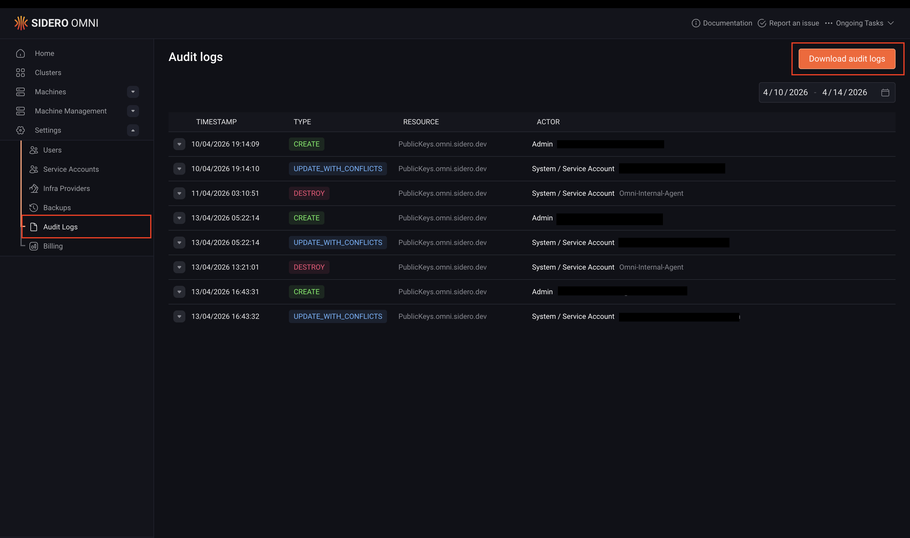

Omni records an audit log of all significant actions taken within an instance, including resource creation, updates, deletions, and access to Kubernetes and Talos clusters. 

Audit logs are useful for security reviews, compliance requirements, and investigating unexpected changes in your environment.

Each log entry captures who performed the action, when it occurred, what resource was affected, and session details such as IP address, user role, and email.

Audit logs are enabled by default on both Omni SaaS and self-hosted Omni.

## Configure audit logs (self-hosted)

On self-hosted Omni, audit log entries are stored in the Omni SQLite database, the file set with `--sqlite-storage-path`. Omni removes entries older than the retention period, 30 days by default. The following flags change this behavior when starting Omni:

| Flag | Default | Description |
|---|---|---|
| `--audit-log-enabled` | `true` | Set to `false` to disable audit logging. |
| `--audit-log-retention-period` | `720h` (30 days) | How long entries are kept before they are removed. |
| `--audit-log-max-size` | `0` (no limit) | The maximum size of the audit log in bytes. When it is exceeded, the oldest entries are removed. |

The same settings are available under `logs.audit` in the Omni configuration file. See the [Omni configuration reference](../reference/omni-configuration#logs-audit) for all audit log options.

## Access the audit log

Audit logs can be accessed through the Omni UI or via `omnictl`. Access requires the `Auditor` or `Admin` role.

<Note>
Audit log access is granted by exact role rather than by seniority. The `Operator` role does not include it, even though it is otherwise more privileged than `Auditor`. Use `Auditor` for accounts that only need to read the audit log, such as an audit log exporter, so they do not need full `Admin` access.
</Note>

<Tabs>
<Tab title="CLI">

To print the entries of the last 29 days to stdout, run:

```bash
omnictl audit-log
```

To keep the command running and print new entries as they are written, add `--follow`:

```bash
omnictl audit-log --follow
```

With `--follow`, the output starts at the newest entry. To include earlier entries, add `--since` with a duration, such as `2h` for the last two hours:

```bash
omnictl audit-log --follow --since 2h
```

`--follow` cannot be combined with dates or with the filters below.

To retrieve entries for a date range, provide start and end dates in `YYYY-MM-DD` format, interpreted in the time zone of the Omni server:

```bash
omnictl audit-log <start-date> <end-date>
```

The range starts at the beginning of the start date and stops at the beginning of the end date, so entries from the end date itself are not included. For example, to retrieve the entries for the first week of August 2024, use `2024-08-08` as the end date:

```bash
omnictl audit-log 2024-08-01 2024-08-08
```

To narrow the output, filter by `--actor`, `--event-type`, `--cluster-id`, or `--resource-id`. For example, to list the resources destroyed by one user:

```bash
omnictl audit-log --actor user@example.com --event-type destroy
```

<Note>The CLI method is preferable for large audit logs or when piping output to a search or filtering tool such as `jq`, as it streams directly to stdout without buffering the entire log in memory.</Note>

</Tab>
<Tab title="UI">

Starting with Omni v1.7, you can open the audit log dashboard by navigating to **Settings > Audit logs**.



</Tab>
</Tabs>

## Audit log format

`omnictl audit-log` prints entries in [JSONL](https://jsonlines.org/) format, one JSON object per line, where each object represents a single audit event.

The following is an example log entry, formatted for readability:

```json
{
  "event_type": "create",
  "resource_type": "Clusters.omni.sidero.dev",
  "resource_id": "talos-default",
  "event_ts": 1723466435280,
  "event_data": {
    "cluster": {
      "id": "talos-default",
      "features": {},
      "kubernetes_version": "1.30.1",
      "talos_version": "1.7.4"
    },
    "session": {
      "user_agent": "Mozilla/5.0 (Macintosh; Intel Mac OS X 10_15_7) AppleWebKit/537.36 (KHTML, like Gecko) Chrome/127.0.0.0 Safari/537.36",
      "client_address": "203.0.113.10",
      "user_id": "fa02ea7c-6eb1-491e-b053-b5db63a4384f",
      "role": "Admin",
      "email": "user@example.com",
      "fingerprint": "0263efb13f3b5016507ec11ba71a96f5fced3a4d"
    }
  }
}
```

### Top-level fields

Every audit log entry has the following top-level fields:

| Field | Description |
|---|---|
| `event_type` | The type of action that occurred. See [Event types](#event-types) below. |
| `resource_type` | The type of resource that was affected, e.g. `Clusters.omni.sidero.dev`. |
| `resource_id` | The ID of the resource that was affected. |
| `event_ts` | The timestamp of the event in milliseconds since Unix epoch. |
| `event_data` | A JSON object containing details about the event. See [Event data fields](#event-data-fields) below. |

### Event types

The `event_type` field takes one of the following values:

| Value | Description |
|---|---|
| `create` | A resource was created. |
| `update` | A resource was updated using the Update mechanism. |
| `update_with_conflicts` | A resource was updated using the UpdateWithConflicts mechanism. |
| `destroy` | A resource was destroyed. |
| `teardown` | A resource is being torn down and will be destroyed shortly. |
| `k8s_access` | A user accessed a Kubernetes cluster. |
| `talos_access` | A user accessed a Talos cluster. |
| `audit_log_access` | The audit log itself was read, including each time the exporter connects to follow it. |

### Event data fields

The `event_data` object contains at least a `session` field, plus one or more resource-specific fields depending on the event type.

#### `session`

The `session` field describes the user session associated with the event.

| Field | Description |
|---|---|
| `user_agent` | The HTTP user agent. For actions performed internally by Omni, this will be `Omni-Internal-Agent` and all other session fields will be empty. |
| `client_address` | The IP address of the client that made the request, including requests through the Kubernetes proxy. See [Client address behind a proxy](#client-address-behind-a-proxy). |
| `user_id` | The ID of the user who performed the action. |
| `role` | The role of the user at the time of the action. |
| `email` | The email address of the user. |
| `fingerprint` | The fingerprint of the user's public key. |
| `confirmation_type` | How the key was confirmed, when applicable. |
| `public_key_expiration` | When the user's public key expires, in seconds since Unix epoch. |

#### Client address behind a proxy

When Omni runs behind a reverse proxy or load balancer, `client_address` shows the client's real address only if the proxy connects to Omni from a private IP address. If the proxy connects from a public IP address, as some cloud load balancers do, `client_address` shows the proxy's address instead.

#### Resource-specific fields

The following fields may appear in `event_data` depending on the resource type involved:

| Field | Description |
|---|---|
| `new_user` | Details of a user that was created, edited, or deleted. |
| `machine` | Details of a machine that was created or destroyed. |
| `machine_labels` | Details of machine label changes. |
| `access_policy` | Details of an access policy change. |
| `cluster` | Details of a cluster change. |
| `machine_set` | Details of a machine set change. |
| `machine_set_node` | Details of a machine set node change. |
| `config_patch` | Details of a config patch change. |

#### `talos_access`

The `talos_access` field is present on `talos_access` events and contains:

| Field | Description |
|---|---|
| `full_method_name` | The full Talos API method name that was called. |
| `cluster_name` | The name of the cluster that was accessed. |
| `machine_ip` | The IP address of the node that was accessed. |

#### `k8s_access`

The `k8s_access` field is present on `k8s_access` events and contains:

| Field | Description |
|---|---|
| `full_method_name` | The full HTTP/2 method name called on the Kubernetes API. |
| `command` | The kubectl command that was run. |
| `kube_session` | The Kubernetes user session details. |
| `cluster_name` | The name of the cluster that was accessed. |
| `cluster_uuid` | The UUID of the cluster that was accessed. |

## Supported resources

The following resource types are recorded in the audit log:

| Resource type | Description |
|---|---|
| `PublicKeys.omni.sidero.dev` | Public key operations. |
| `Users.omni.sidero.dev` | User management operations. |
| `Identities.omni.sidero.dev` | Identity management operations. |
| `Machines.omni.sidero.dev` | Machine registration and removal. |
| `MachineLabels.omni.sidero.dev` | Machine label changes. |
| `AccessPolicies.omni.sidero.dev` | Access policy changes. |
| `Clusters.omni.sidero.dev` | Cluster creation, updates, and deletion. |
| `MachineSets.omni.sidero.dev` | Machine set changes. |
| `MachineSetNodes.omni.sidero.dev` | Machine set node changes. |
| `ConfigPatches.omni.sidero.dev` | Config patch changes. |

In addition to resource operations, Omni also logs `kubectl` access to Kubernetes clusters and direct access to Talos nodes via `talosctl`.

## Export audit logs

For a one-off export, `omnictl audit-log` streams to stdout and pipes into any external tool. Without arguments, it covers the last 29 days. To export every entry Omni still keeps, set `--since` to a duration at least as long as the retention period, such as `720h` for the default 30 days:

```bash
omnictl audit-log --since 720h | jq .
```

To keep audit events flowing into a log aggregation or SIEM system continuously, use the audit log exporter, which follows the audit log and resumes where it left off across restarts. See [Export Audit Logs](./export-audit-logs).
